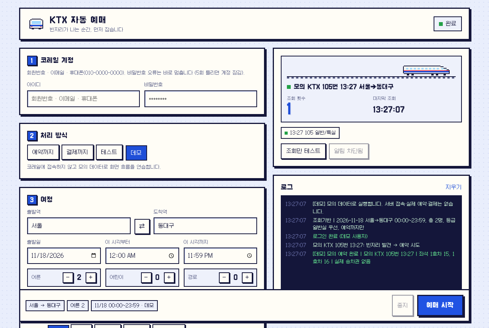

# KTX Auto Reservation

KTX 잔여석을 주기적으로 조회해 좌석이 확보되는 즉시 예약하는 개인용 자동 예매 도구입니다.

[ktx-auto](https://github.com/ShinbaramEbaksa/ktx-auto)를 기반으로 개선한 프로젝트로, 코레일톡 7.1.0 업데이트 이후 동작하지 않던 원본을 Python으로 재구현하고 설치·알림·결제 기능을 확장했습니다.

- 인수인계: [HANDOVER.md](HANDOVER.md)
- 설명서: [사용설명서.txt](ktx_reserve/사용설명서.txt) · [PDF](downloads/ktx-windows-fixed/KTX_MANUAL.pdf)
- 배포본: [macOS](downloads/ktx-reserve-final.zip) · [Windows](downloads/KTX_WINDOWS_FIXED.zip)



## Features

- 로컬 웹 UI (픽셀 아트 스타일, 라이트/다크 모드)
- 출발·도착역, 날짜, 시간대, 인원, 좌석 등급 조건으로 잔여석 반복 조회 및 즉시 예약
- 2인 이상 연석 예약 (`--adjacent`)
- 예약 후 카드 자동 결제 (`--pay`)
- macOS 알림 센터 · Discord 알림
- 세션 만료, 매크로 감지, 네트워크 오류 자동 복구 / 인증 실패 시 즉시 중단(계정 잠금 방지)
- macOS · Windows 지원

## Quick Start

```bash
bash setup.sh      # 최초 1회 (Windows: setup.bat)
bash ui.sh         # 설정 화면 실행 → http://127.0.0.1:3939 (Windows: ui.bat)
```

터미널에서 직접 실행할 수도 있습니다.

```bash
bash run.sh --dep 서울 --arr 동대구 --date 2026-12-01 --from 13:00 --to 15:00 --adult 2
```

`--check`로 로그인 없이 조회만 확인할 수 있습니다. 전체 옵션은 `bash run.sh --help`를 참고하세요.

## Changelog

| 버전 | 날짜 | 내용 |
|---|---|---|
| v1.5 | 2026-11-18 | 로컬 웹 UI 추가 (픽셀 아트 스타일) |
| v1.4 | 2026-11-18 | 브랜치 통합, 문서 정리 |
| v1.3 | 2026-11-05 | 한글 설명서(txt/PDF/HTML), 배포 패키지 |
| v1.2 | 2026-11-04 | Windows 지원, Discord 알림, 결제 입력 검증 및 결과 보고 |
| v1.1 | 2026-11-04 | pykorail 버전 고정, 설치 자동화, `--check` · `--demo` 모드, 테스트 추가 |
| v1.0 | 2026-11-02 | Python + pykorail 기반 재구현 |
| v0 | ~2026-09 | 원본 ktx-auto (TypeScript). 앱 7.1.0 업데이트 후 `-8204` 오류로 동작 중단 |

## Comparison with ktx-auto

| | ktx-auto | This project |
|---|---|---|
| Language | TypeScript | Python |
| UI | 로컬 웹 (Liquid Glass) | 로컬 웹 (Pixel Art) |
| API client | 자체 구현 | pykorail (DynaPath SDK 2.0.1) |
| Payment | 웹 브라우저 자동화 | API 결제 |
| Notification | Web Push | macOS · Discord |
| Platform | macOS | macOS · Windows |

## Status

조회, 로그인, 예약, 결제 전 과정을 실서버에서 검증했습니다 (macOS · Windows).

## Notes

- `start_booking` 스크립트에는 기본 일정이 지정되어 있으므로 사용 전 수정이 필요합니다.
- 과도한 요청은 코레일 이용 제재 대상이 될 수 있습니다. 조회 간격은 기본값 사용을 권장합니다.
- 본인 탑승 목적으로만 사용하세요.

## Credits

- [ktx-auto](https://github.com/ShinbaramEbaksa/ktx-auto) — 원본 프로젝트
- [pykorail](https://github.com/ArchsouL/pykorail) — 코레일 API 클라이언트 (상업적 이용 금지, [THIRD_PARTY.md](ktx_reserve/THIRD_PARTY.md))
